<p align="center"></p>

<p align="center"><strong>Behavioral OSINT and Detection by Absence</strong><br>Um framework de pesquisa para transformar <em>observações esperadas que não aconteceram</em> em inteligência auditável, sem confundir silêncio com falha de coleta.</p>

<p align="center"><a href="README.md">English</a> · <a href="docs/methodology.md">Metodologia</a> · <a href="docs/architecture.md">Arquitetura</a> · <a href="docs/detection-v2.md">Detecção v0.2</a> · <a href="docs/research-evidence.md">Evidência</a> · <a href="docs/osint-feeds.md">Feeds OSINT</a> · <a href="docs/ethics-and-scope.md">Ética</a></p>

<p align="center">       </p>

## O problema

A maioria dos fluxos de OSINT é otimizada para **presença**: encontrar conta, post, domínio, vínculo ou artefato. O T.O.C.A.I.A adiciona outra pergunta:

> **O que deveria ser observável aqui, sob esta cobertura de coleta, mas não apareceu?**

Um resultado vazio pode significar coisas opostas:

- `data_gap` → **não observamos o suficiente para saber**;
- `behavioral_gap` → **observamos adequadamente e o evento esperado não ocorreu**.

Misturar os dois é fabricar certeza em cima de coleta quebrada.

## O método

Cada etapa precisa produzir um artefato que outro analista consiga revisar.

| Etapa | Pergunta de controle | Artefato mínimo |
|---|---|---|
| **T · Terreno** | Qual decisão, unidade, janela e limite legal/ético? | Ficha de escopo + postura |
| **O · Observação** | O que foi observado, coletado, bloqueado ou perdido? | Registro bruto + procedência |
| **C · Correlação** | Os registros são comparáveis no tempo e entre fontes? | Timeline normalizada + mapa de fontes |
| **A · Ausência** | O evento esperado seria detectável? O que faltou? | Registro de lacunas |
| **I · Inferência** | Quais explicações concorrentes sobrevivem melhor? | ACH / matriz de hipóteses + confiança |
| **A · Aferição** | O que derrubaria a conclusão e outro analista reproduz? | Revisão adversarial + critério de revisão |

## O diferencial

1. **Detectabilidade antes da interpretação.** Zero sem cobertura adequada não é ausência.
2. **Baseline antes da anomalia.** Sem normal declarado, não existe desvio defensável.
3. **Hipóteses concorrentes.** Refutação acima de narrativa.
4. **Confiança explícita.** Força da evidência, confiança analítica e probabilidade do evento não viram um único score mágico.
5. **Custódia da ausência.** Lacunas são registradas com tempo, escopo e procedência.
6. **Passivo por desenho.** A implementação pública não inclui mensagem, seguir, curtida, engenharia social ativa ou acesso autenticado ao alvo.

## Teste rápido

```bash
git clone https://github.com/Ridd1kulusC0d3r/tocaia-osint.git
cd tocaia-osint
python -m pip install -e .
tocaia-analyze examples/synthetic-bx7/weekly.csv
```

O conjunto `BX-7` é **100% sintético** e serve apenas para demonstrar a diferença entre falha de observação e ausência comportamental.

## Pesquisa sem maquiagem

O projeto mantém um [registro público de alegações](research/claim-register.md) com os estados `validated`, `synthetic-only`, `refuted` e `unmeasured`. Resultado negativo continua no histórico. Do contrário, vira marketing com estatística decorativa, que a humanidade já produz em quantidade industrial.

## Escopo

Uso defensivo, pesquisa, treinamento, auditoria e análise reproduzível de informações legitimamente acessíveis em fontes abertas. Não é ferramenta de perseguição, doxxing, atribuição automática de identidade, diagnóstico psicológico ou engajamento ativo com alvo.

Exemplos públicos devem ser sintéticos ou adequadamente anonimizados. Materiais com pessoas reais, contato pessoal direto ou marcação de uso restrito ficam fora da distribuição pública.

## Licença

- **Código:** MIT
- **Framework, documentação e templates:** CC BY 4.0

---

**Tocaia é espera com método.** Observe primeiro. Separe falha de coleta de ausência comportamental. Infira por último.
